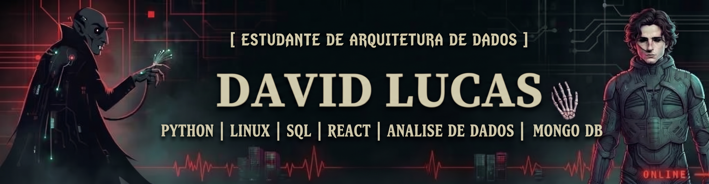

  <picture>
    <source media="(prefers-color-scheme: dark)" srcset="IMGPRINCIPAL.jpg">
    <source media="(prefers-color-scheme: light)" srcset="IMGPRINCIPAL.jpg">
    
  </picture>

<h1 align="center">🦇 DAVID LUCAS 🦇</h1>

<em>[ ESTUDANTE DE ARQUITETURA DE DADOS & ANALISTA DE SUPORTE ]</em>

---

## 🧛‍♂️ ⸸ Sobre Mim

Profissional de TI com sólida vivência em suporte técnico avançado, atendimento multicanal, triagem e escalonamento assertivo de incidentes críticos. Especialista em investigações de falhas utilizando **Postman, Datadog e SOAP**, além de ampla experiência em consultas e manipulação de dados em bancos relacionais e não relacionais (**PostgreSQL, SQL Server e MongoDB**). Atualmente cursando Arquitetura de Dados, integrando suporte de alta performance com engenharia e modelagem de dados.

---

## 🛠️ ⸸ Stack Tecnológica & Ferramentas

| Categoria | Tecnologias / Competências |
| :--- | :--- |
| **🦇 Suporte & Operações** | Suporte N1/N2, Triagem de Chamados, SLAs, ITIL, Atendimento Multicanal (SAC) |
| **🗄️ Bancos de Dados** | PostgreSQL, SQL Server, MongoDB (NoSQL), Modelagem de Dados |
| **⚡ APIs & Monitoramento** | Postman, SOAP / REST, Datadog (Logs & Métricas) |
| **💻 Linguagens & Web** | Python, JavaScript, HTML5, CSS3, C, Java OO, Tailwind CSS |
| **⚙️ Ambiente & Ferramentas** | Windows 11, Git, GitHub, Android Studio, Vercel |

---

## 🚀 ⸸ Principais Projetos Pessoais & Labs

*(Desenvolvidos para estudo, automação e validação de dados)*

* 🧠 [**BASE DE CONHECIMENTO**](https://github.com/DAVID-PROFILLE-24/base-2-new-new)
  * *Objetivo:* Centraliza e padroniza procedimentos técnicos, facilitando o suporte diário de analistas e o acesso rápido a novas informações.

---

## 📈 ⸸ Experiência Profissional Recente

* 🏢 **Vsoft** *(2024 – 2026)* — *Analista de Suporte N1/N2*
  * Diagnóstico avançado, investigações de APIs com Postman/Datadog/SOAP, manipulação de PostgreSQL/MongoDB e documentação de troubleshooting para redução de MTTR.

* 🏢 **Softcom Tecnologia** *(2022 – 2024)* — *Analista de Suporte Técnico*
  * Atendimento multicanal, triagem estruturada para níveis superiores, suporte a Microsoft SQL Server e documentos fiscais eletrônicos.

* 🏥 **Hospital João Paulo II** *(2017 – 2019)* — *Jovem Aprendiz – Suporte de TI*
  * Suporte de infraestrutura (hardware/software), treinamento de colaboradores e gestão de inventário.

---

## 📫 ⸸ Como me encontrar

* 📧 **E-mail:** `david.tottenham.roc@gmail.com`
* 📱 **Telefone / WhatsApp:** `(83) 99647-7447`
* 💼 **LinkedIn:** [www.linkedin.com/in/david-lucas-b52598241](https://www.linkedin.com/in/david-lucas-b52598241)

  

